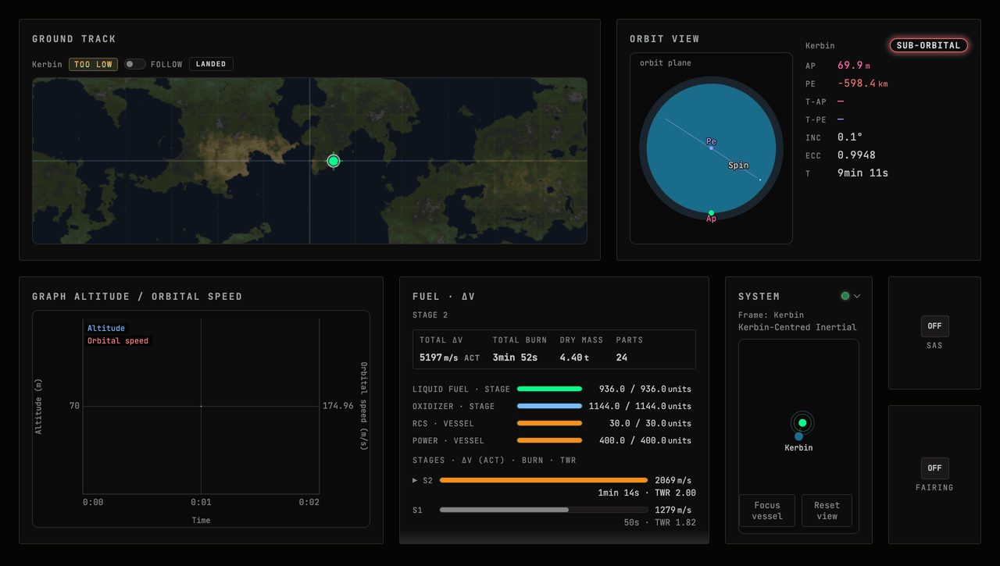
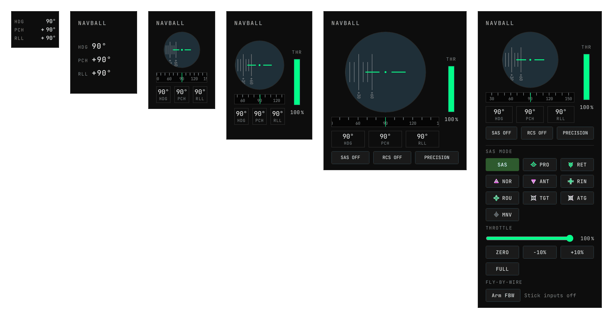
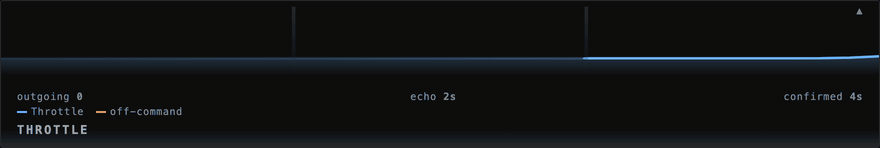
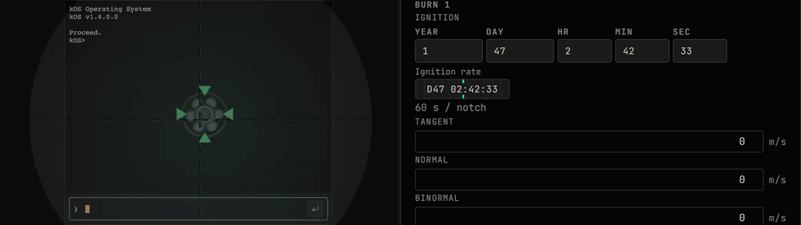

[](https://github.com/ksp-gonogo/gonogo/pkgs/container/gonogo)

# Gonogo

A telemetry mod system and mission control dashboard for [Kerbal Space Program](https://www.kerbalspaceprogram.com/). The mod captures live data and makes it available through an API. The Gonogo app provides a UI for a multiplayer mission control experience, with movable widgets for all kinds of data.

[](https://www.npmjs.com/package/@ksp-gonogo/sitrep-sdk)
[](https://www.npmjs.com/package/@ksp-gonogo/ui-kit)
[](https://www.npmjs.com/package/@ksp-gonogo/uplink-tools)
[](https://www.nuget.org/packages/KspGonogo.Sitrep.Contract/)

**Quickstart:** [Gonogo Home Page](https://ksp-gonogo.github.io/)

**Joining a friend's game?** Nothing to install: [jump to joining](#joining-a-friends-game).



<p align="center">
  
</p>

## Signal Delay



Gonogo features an _optional_ signal delay, on by default. Signals in the game are modelled under a real propagation system; it takes longer to get flight data from vessels further away, and vessels occluded behind planets and out of range won't be able to communicate. Signals get routed through available relay nodes to command centres, via a model heavily inspired by [NASA's Contact Graph Routing](https://ntrs.nasa.gov/citations/20120006508) system.

### Pilots and stations

Every screen has a seat. A **station** is a screen at mission control, so it sees the active vessel with the signal delay. A **pilot** is a screen on the active vessel, so it sees the vessel with no delay, as if from the cockpit. Any number of either can join. Pilots share one Commcast name and cannot push widgets to the main screen. See [Starting a game](#starting-a-game) and [Joining a game](#joining-a-game).

## Uplinks

Uplinks are the name for Gonogo's own mod support. They can extend and modify core behaviour and widgets, and add their own. Uplinks are generally used for creating integrations with other KSP mods. Uplinks currently exist for mods like [kOS](https://github.com/ksp-gonogo/gonogo-uplinks/blob/main/uplinks/kos/README.md), [SCANSat](https://github.com/ksp-gonogo/gonogo-uplinks/blob/main/uplinks/scansat/README.md), [Kerbcast](https://github.com/ksp-gonogo/gonogo-uplinks/blob/main/uplinks/kerbcast/README.md), [RP-1](https://github.com/ksp-gonogo/gonogo-uplinks/blob/main/uplinks/rp1/README.md), and [Principia](https://github.com/ksp-gonogo/gonogo-uplinks/blob/main/uplinks/principia/README.md).

_You can search for Uplinks in CKAN by filtering for `dep:Gonogo`._

<p align="center">
  
</p>

## Recommended Ways to Play

_Mission Control_. Use KSP exclusively for VAB/SPH. Either automate flights or have a pilot crew team in another location for flights. Run Gonogo to create a mission control dashboard, and have everyone in your group join as their own station for their own discipline. At large distances, you'll notice that the dashboard takes longer to receive data; you'll have to plan better.

_Data Visualisation Companion_. Run Gonogo as a second screen while you fly, to track data that you care about.

## Host it yourself

You need KSP 1.12 and Docker, or another container tool such as Podman.

1. Install the Gonogo mod from CKAN or SpaceDock. To install it by hand, see [KSP setup](docs/KSP-SETUP.md)
2. Get [Docker](https://docs.docker.com/get-started/get-docker/) or similar, and start it
3. Paste this into a terminal, with the KSP computer's IP address in place of `<ksp-ip>`. On Windows, use the Windows command below

```bash
docker run -d --name gonogo --restart unless-stopped --pull always \
  -e KSP_HOST=<ksp-ip> \
  -p 8080:8080 -p 127.0.0.1:3002:3002 \
  -p 47100:47100/udp -p 47100:47100/tcp \
  ghcr.io/ksp-gonogo/gonogo:latest
```

Find the IP on the KSP computer: `ipconfig` on Windows (IPv4 Address), `ip addr show` on Linux, or System Settings, Network on macOS.

<details>
<summary>KSP on this computer</summary>

Use `host.docker.internal` as the address, and add the `--add-host` line:

```sh
docker run -d --name gonogo --restart unless-stopped --pull always \
  --add-host=host.docker.internal:host-gateway \
  -e KSP_HOST=host.docker.internal \
  -p 8080:8080 -p 127.0.0.1:3002:3002 \
  -p 47100:47100/udp -p 47100:47100/tcp \
  ghcr.io/ksp-gonogo/gonogo:latest
```

</details>

<details>
<summary>Windows</summary>

Press Start, type PowerShell, open Windows PowerShell, then right-click to paste this and press Enter. Do not paste the version above with `\` there. Put the KSP computer's IP address in place of `<ksp-ip>` before pressing Enter.

```powershell
docker run -d --name gonogo --restart unless-stopped --pull always -e KSP_HOST=<ksp-ip> -p 8080:8080 -p 127.0.0.1:3002:3002 -p 47100:47100/udp -p 47100:47100/tcp ghcr.io/ksp-gonogo/gonogo:latest
```

</details>

<details>
<summary>Podman</summary>

Podman 5 or later. Type `podman` in place of `docker`, in this command and every other one here. On macOS and Windows, run `podman machine start` first. With rootless Podman, use this computer's IP address in place of `host.docker.internal` when KSP runs on it.

</details>

   `127.0.0.1:3002` keeps the relay's own port on this computer only; leave it as it is. Every setting the container takes is in [the settings table](docs/CONFIGURATION.md).

   If Docker says the name `gonogo` is already in use, a container from an earlier install exists. Run `docker rm -f gonogo`, then the command again.

   For friends joining from another network, see the [networking guide](docs/NETWORKING.md#friends-on-other-networks).

4. Start KSP, load a save, and open [localhost:8080](http://localhost:8080)

The setup wizard opens by itself and checks the container, the connection to KSP and your Uplinks. It explains anything that is wrong, and Settings > Help covers the rest. When its Connect to KSP check turns green you are connected; widgets fill in once you are at a vessel. If friends will join from other networks, the wizard also has a Friends on other networks step about a router port, explained in the [networking guide](docs/NETWORKING.md#friends-on-other-networks).

## Starting a game

The last step of the setup wizard shows two cards, each with a short explanation of the seat it starts you in:

- **Start as mission control**: this screen is the main screen, with the signal delay
- **Start as a pilot**: this screen is a pilot screen on the active vessel, with no delay

Either way, this screen is the **host** of the game. The host holds the game's one join code and approves everyone who joins. It does not have to be the computer running KSP, it only has to be able to reach it.

- **Next time:** the screen opens in the seat it last used
- **Switching seat:** the host has a link to switch between mission control and pilot. Switching never changes who hosts, and everyone already connected stays connected
- **Mission control to pilot:** the game is left with no main screen, so you are asked to confirm first, and told how many stations are connected. With no main screen, the Push icon in a widget's header on a station, which appears when you hover, is disabled with the tooltip "No main screen"

Keep the host's tab open while you play. Everyone else's screen gets its data through it, and stops if it closes or the computer sleeps.

## Inviting people

Open the round **Menu** button in the corner of any screen, then **Invite**. It shows one address, with a QR code and the code in large type. Send that address, show the QR code or read out the code. Use the address Invite shows rather than typing one, because it matches the version you run. Anyone already in the game can invite the next person. The host can make a new code from the Invite panel, and the old address and code stop working

Address, QR code and code all lead to the same place, the join page below.

## Joining a game

Open the address you were sent, scan the QR code, or go to the front page of [the Gonogo site](https://ksp-gonogo.github.io/) and type the code into **Join a game**. The app's own join page also asks for the code when you open it without one. Nothing to install.

1. **The code is checked.** Gonogo looks for the game. If there is none, you see "No game is running on this code". Check that the code is right and that the host is running
2. **Choose a seat.** Two cards appear, each with live details such as "3 stations connected" or "2 pilots aboard":
   - **Join as a station**: "A screen at mission control. Your connection is based at the active command centre. You can lose connection to the active vessel, but command centre control is always available."
   - **Join as a pilot**: "A screen on the active vessel. Your connection is linked to the active vessel. You can lose connection to the command centre, but vessel data is always live and instant."
3. **Wait for the host to approve you.** Choosing a card sends your request, and a prompt appears on the host's screen, and your screen waits until the host approves it

To change seat later, go back to the join page with the same code and choose the other card. The host approves you again.

A joining station gets a made-up name such as "Station U8R5", and a pilot is named "Pilot". Change either in Settings > General. A joined screen's Settings show only what its seat needs: General (your name), Devices (its own controllers), Connection (the code it joined with, and the **Leave** button) and Help. A host sees everything.

KSP stops sending data when its window loses focus. With KSP and Gonogo on one computer, close KSP, set `SIMULATE_IN_BACKGROUND = True` in `settings.cfg` in the KSP folder, and save.

### Firewall

- Windows: if asked, tick Private networks and Allow for KSP and Docker
- Linux with ufw: `sudo ufw allow in on docker0 to any port 8090 proto tcp`, so the container can reach KSP. Ports Docker publishes (`8080`, `47100`) ignore ufw
- Never forward port 8090 to the internet: it accepts commands to your game with no password

## Upgrading from an earlier version

- **Mod:** replace the `Gonogo` folder in `GameData`, or update it through CKAN
- **App:** run `docker rm -f gonogo` to remove the existing container (the run command refuses to start while one has the name), then the `docker run` command above again ([`--pull always`](https://docs.docker.com/reference/cli/docker/container/run/) fetches the newest image)
- **Uplinks:** update each one through CKAN, or replace its folder in `GameData`. An Uplink built for another Gonogo version will refuse to run

## If something is not working

Use **Settings > Connection > Run setup again**.

- `docker ps` should list `gonogo`
- `docker logs --tail 50 gonogo` says why it stopped
- Another program on port 8080: `docker rm -f gonogo`, then change the left number in `-p 8080:8080` and run it again

## More

- [Uplink developer docs](https://ksp-gonogo.github.io/uplink-dev-docs/)
- [API reference](https://ksp-gonogo.github.io/gonogo/api/)
- [KSP setup](docs/KSP-SETUP.md) and [networking](docs/NETWORKING.md)
- [Contributing](CONTRIBUTING.md)
- [Licence](LICENSE)
