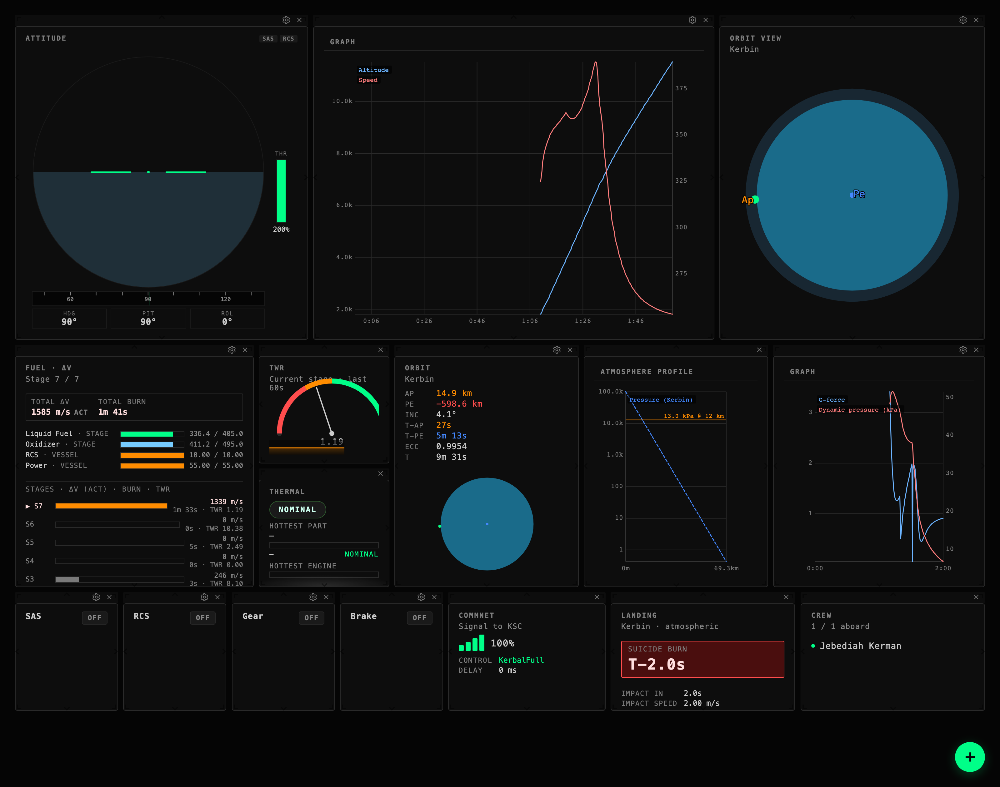
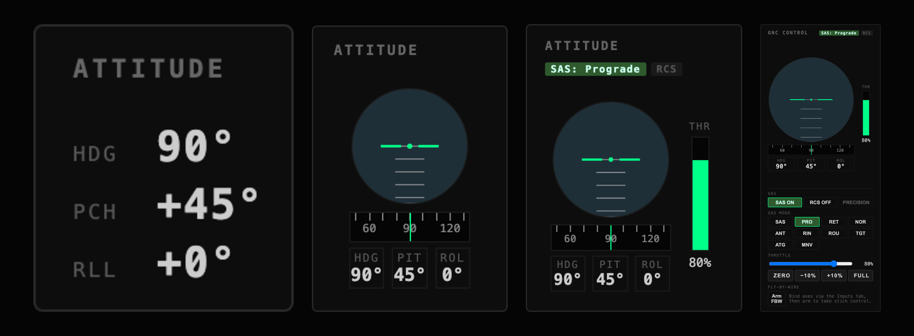
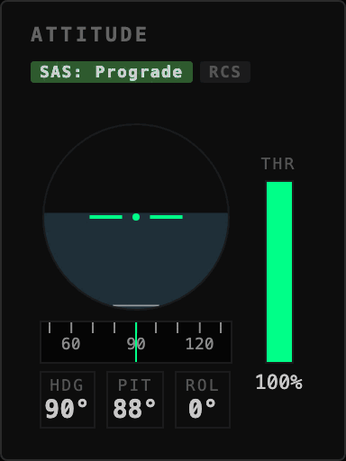

# Gonogo

A telemetry mod system and mission control dashboard for [Kerbal Space Program](https://www.kerbalspaceprogram.com/). The mod captures live data and makes it available in an API. The Gonogo app provides a UI for a multiplayer mission control experience, with movable widgets for all kinds of data.

**Quickstart:** [Gonogo Home Page](https://ksp-gonogo.github.io/)

**Joining a friend's game?** Nothing to install: [jump to joining](#joining-a-friends-game).



<p align="center">
  
  
</p>

## Real Light Delay

Gonogo features an _optional_ realistic light delay option, on by default. Signals in the game gets modelled under a real propagation system; it takes longer to get flight data from vessels further away, and vessels occluded behind planets and out of range won't be able to communicate. Signals get routed through available relay nodes to command centres, via a model heavily inspired by [NASA's Contact Graph Routing](https://ntrs.nasa.gov/citations/20120006508) system.

## Uplinks

Uplinks are the name for Gonogo's own mod support. They can extend and modify core behaviour and widgets, and add their own. Uplinks are generally used for creating integrations with other KSP mods. Uplinks currently exist for mods like [kOS](https://github.com/ksp-gonogo/gonogo-uplinks/blob/main/uplinks/kos/client/README.md), [SCANSat](https://github.com/ksp-gonogo/gonogo-uplinks/blob/main/uplinks/scansat/client/README.md), [Kerbcast](https://github.com/ksp-gonogo/gonogo-uplinks/blob/main/uplinks/kerbcast/client/README.md), [RP-1](https://github.com/ksp-gonogo/gonogo-uplinks/blob/main/uplinks/rp1/client/README.md), and [Principia](https://github.com/ksp-gonogo/gonogo-uplinks/blob/main/uplinks/principia/client/README.md).

_You can search for Uplinks in CKAN by filtering for `dep:GonogoCore`._

## Recommended Ways to Play

_Mission Control_. Use KSP exclusively for VAB/SPH. Either automate flights or have a pilot crew team in another location for flights. Run Gonogo to create a mission control dashboard, and have everyone in your group join as their own station for their own discipline. At large distances, you'll notice that the dashboard takes longer to receive data; you'll have to plan better.

_Data Visualisation Companion_. Run Gonogo as a second screen while you fly, to track data that you care about.

## Host it yourself

You need KSP 1.12.

1. Install the mod: search for `Gonogo` in [CKAN](https://github.com/KSP-CKAN/CKAN/wiki/Installing-CKAN)
2. Install and open [Docker Desktop](https://docs.docker.com/get-started/get-docker/)
3. Paste this into a terminal (on Windows, as one line: remove the `\` and the line breaks)

```bash
docker run -d --name gonogo --restart unless-stopped \
  --add-host=host.docker.internal:host-gateway \
  -e KSP_HOST=host.docker.internal \
  -p 8080:8080 -p 3002:3002 \
  -p 3478:3478/tcp -p 3478:3478/udp \
  -p 49160-49170:49160-49170/udp \
  ghcr.io/ksp-gonogo/gonogo:rc
```

4. Start KSP and open [localhost:8080](http://localhost:8080)

The setup wizard opens by itself and checks the container, the connection to KSP and your Uplinks. It explains anything that is wrong, and Settings > Help covers the rest.

## Joining a friend's game

Open the link from their **Add station** panel and enter the share code. Nothing to install.

## If something is not working

Use **Settings > Connection > Run setup again**.

- `docker ps` should list `gonogo`
- `docker logs --tail 50 gonogo` says why it stopped
- Another program on port 8080: `docker rm -f gonogo`, then change the left number in `-p 8080:8080` and run it again

## More

- [Uplink developer docs](https://ksp-gonogo.github.io/uplink-dev-docs/)
- [AsyncAPI reference](asyncapi.yaml) (open it in [AsyncAPI Studio](https://studio.asyncapi.com/) to browse it)
- [KSP setup](docs/KSP-SETUP.md) and [networking](docs/NETWORKING.md)
- [Contributing](CONTRIBUTING.md)
- [Licence](LICENSE)
