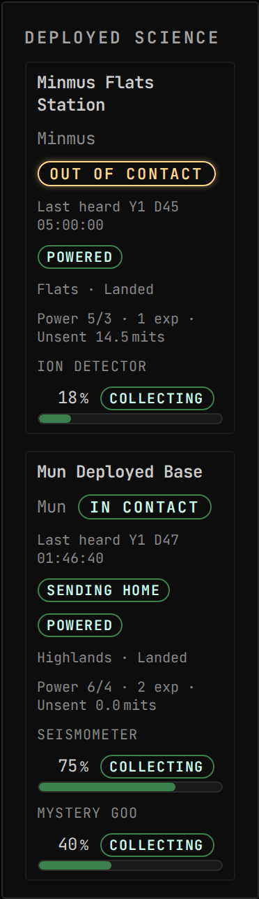
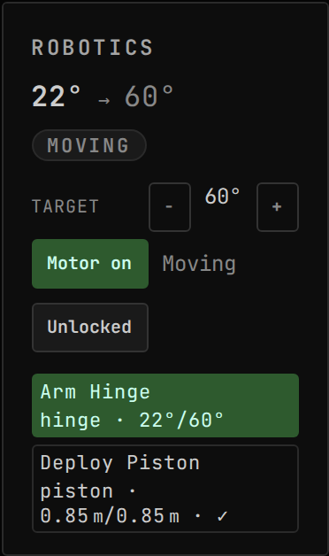
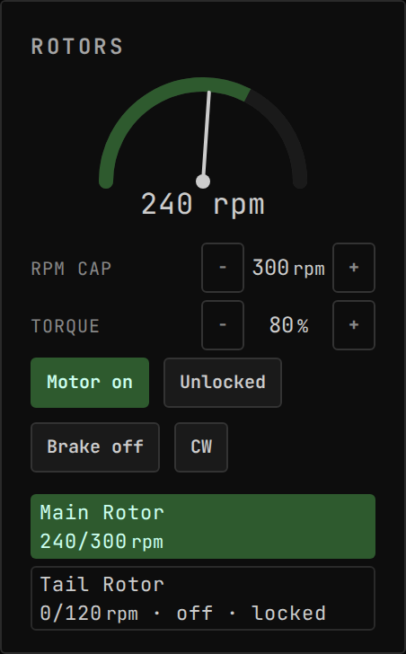

<!-- Generated by `uplink-tools docs` or `uplink-tools page`. Do not edit this file: it is written
     from the registrations, the contract slice and the fixtures. -->

# Breaking Ground

Drives Breaking Ground robotic joints and rotors from the console, and reports deployed surface bases on every body while you fly something else.

| | |
| --- | --- |
| Uplink id | `breakingGround` |
| Version | `0.0.1` |
| Built against | contract 46.0, extension API 6.0.0 |

## Install

The Breaking Ground Uplink comes with Gonogo, so there is nothing separate to install. Installing Gonogo installs it.

## Widgets

### Deployed Science

Whether each Breaking Ground deployed station's science is reaching home and when it was last heard, with its power balance and per-experiment science progress, reported even while you fly something else. Read-only.

| | |
| --- | --- |
| Widget id | `deployed-science` |
| Reads | `trackingStation.catalog`, `game.dlc` |
| Also reads, if the mod publishes them | `deployed.station.<vesselId>.report` |
| Slots of its own | `deployed-science.experiment` |
| Default size, in grid units | 5 × 9 |
| Smallest size, in grid units | 5 × 7 |
| Scenes | 4 |

### Robotics Console

Current-vs-target position, at-target state and motor/lock controls for Breaking Ground robotic hinges, rotation servos and pistons. Select a joint to drive it from the stepper or a mapped input.

| | |
| --- | --- |
| Widget id | `robotics-console` |
| Reads, as dotted paths (a Topic id or a field of its payload) | `robotics.servos`, `robotics.available.available`, `game.dlc.breakingGround` |
| Actions an input can be bound to | Target + (`target-up`): Increase the selected joint's target; Target − (`target-down`): Decrease the selected joint's target; Toggle motor (`toggle-motor`): Engage / disengage the selected joint's motor; Toggle lock (`toggle-lock`): Lock / unlock the selected joint |
| Needs | a vessel in flight |
| Default size, in grid units | 5 × 8 |
| Smallest size, in grid units | 4 × 4 |
| Scenes | 3 |

### Rotor Tachometer

Live RPM vs commanded cap for Breaking Ground robotic rotors, with motor, lock, brake and direction controls. Select a rotor to drive it from the dial or a mapped input.

| | |
| --- | --- |
| Widget id | `rotor-tachometer` |
| Reads, as dotted paths (a Topic id or a field of its payload) | `robotics.servos`, `robotics.available.available`, `game.dlc.breakingGround` |
| Actions an input can be bound to | RPM up (`rpm-up`): Raise the selected rotor's RPM cap; RPM down (`rpm-down`): Lower the selected rotor's RPM cap; Toggle motor (`toggle-motor`): Engage / disengage the selected rotor's motor; Toggle lock (`toggle-lock`): Lock / unlock the selected rotor; Reverse (`reverse`): Flip the selected rotor's spin direction |
| Needs | a vessel in flight |
| Default size, in grid units | 6 × 10 |
| Smallest size, in grid units | 4 × 4 |
| Scenes | 3 |

