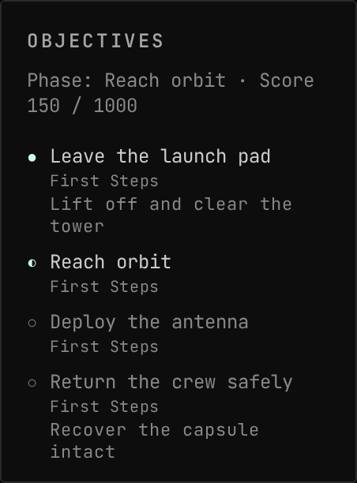

<!-- Generated by `uplink-tools docs` or `uplink-tools page`. Do not edit this file: it is written
     from the registrations, the contract slice and the fixtures. -->

# Making History

Lists the running Making History mission's objectives in the Objectives widget, each marked pending, under way, reached or failed.

An Uplink for [Gonogo](https://ksp-gonogo.github.io/), the mission-control dashboard for Kerbal Space Program that runs in a web browser on any screen.

## Install

The Making History Uplink comes with Gonogo, so there is nothing separate to install. Installing Gonogo installs it.

## What it adds to other widgets

| |
| --- |
|  `objectives-making-history` in `objectives.source` |

## For developers

Uplink details

| | |
| --- | --- |
| Uplink id | `makingHistory` |
| Version | `0.0.1` |
| Built against | contract 51.0, extension API 6.0.0 |

Augments

| Augment | Into | Reads | Presence | Scenes | Notes |
| --- | --- | --- | --- | --- | --- |
| `objectives-making-history` | `objectives.source` | `missions.active` |  | 1 |  |

